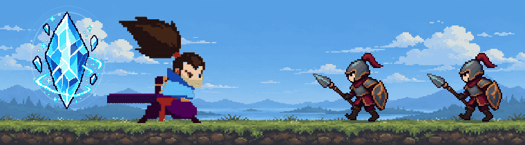

# Pham Tuan Dat

### Unity Game Developer | Moving into Game Monetization

I'm a Unity developer with two years of experience building mobile games in C#. I have worked on gameplay, UI, animation, AI, physics, and performance optimization, and have used player data to help improve the game experience.

I'm now focusing my career on **game monetization**. I want to combine my Unity development background with my analytical and coordination skills to build ad experiences that support sustainable revenue while respecting gameplay and players.

## About me

- 🎓 Computer Engineering graduate from the University of Engineering and Technology, VNU
- 🎮 Unity game developer at Weegoon / Ohze Game from July 2023 to August 2025
- 🔎 Currently working in deployment, gathering requirements, planning delivery, and coordinating teams
- 🌱 Building my next chapter in Unity game monetization

## Skills

- **Game development:** Unity, C#, C, C++, .NET, gameplay systems, UI, animation, AI, physics, mobile optimization
- **Analysis:** Requirements elicitation, stakeholder interviews, user stories, BRD/SRS, requirement traceability, BPMN, sequence diagrams, ERD, REST API specifications
- **Data and tools:** MySQL, SQL Server, Figma, Draw.io, MS Visio, Git
- **Collaboration:** Problem solving, self-learning, time management, team coordination, leadership
- **English:** TOEIC 680

## Current focus

Transitioning into game monetization by applying my Unity and player-data experience to ad implementation and thoughtful placement, with a focus on balancing revenue, retention, and player experience.

## Contact

- Portfolio: [mythptd.github.io](https://mythptd.github.io/portfolio/)
- Email: [ptdatmyth261201@gmail.com](mailto:ptdatmyth261201@gmail.com)

## Steel Tempest

  

